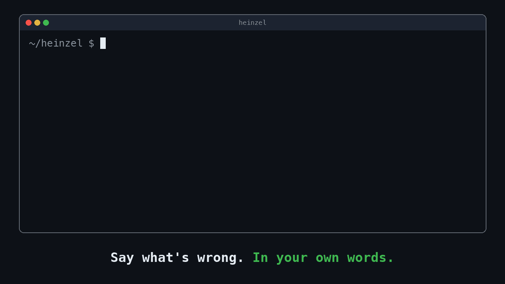

# Heinzel

**The sysadmin that asks first.** Heinzel is a set of rules
that turns an AI coding assistant into a cautious admin for
your servers. Say what you need in plain English. Heinzel
works out the commands for that OS, explains each one and
waits for your yes.

It runs on Linux, FreeBSD, NetBSD, OpenBSD and macOS, over
SSH or on the local machine, inside
[Claude Code](https://docs.anthropic.com/en/docs/claude-code),
[OpenCode](https://opencode.ai) or any terminal AI tool that
reads project files and runs shell commands.



Watch it work:
[fix a broken nginx and firewall](https://www.youtube.com/watch?v=_uenftahbJI) (1 min),
[install Ruby on Rails](https://www.youtube.com/watch?v=QVvm29eABKY) (1 min),
[firewall, distribution upgrade and security updates](https://www.youtube.com/watch?v=ve_TFyJy_uU) (2 min).
In the press:
[Heinzel on heise.de](https://www.heise.de/ratgeber/KI-Assistent-Heinzel-fuer-die-Server-Administration-im-Ueberblick-11244463.html)
(German).

## Quick start

You need an AI coding assistant in the terminal and SSH
access to the server with a key that asks for no passphrase.
On Windows use
[WSL](https://learn.microsoft.com/windows/wsl/) or the Git
Bash of [Git for Windows](https://gitforwindows.org/).

```
git clone https://github.com/wintermeyer/heinzel.git
cd heinzel
claude        # or: opencode
```

```
❯ Install postgresql on server1.example.com
```

On first contact Heinzel detects the OS, loads the rules for
it and asks what it cannot find out, usually the SSH user.
It asks once: the answer goes to `memory/user.md`.

## What you can ask

- `Check on web1.example.com`: picks up where the last
  session ended.
- `Run housekeeping on app.example.com`: disk, memory,
  updates, firewall, certificates, failed services. Problems
  first.
- `Run a security audit on app.example.com`: SSH, firewall,
  accounts and open ports, by severity.
- `Email me the output of "df -h" from app.example.com`
- `Clean up leftovers of old apps on this Mac`
- `/plan Migrate the database on db.example.com`: a plan
  first, no change until you approve.

Every server gets its own memory: state, changelog and open
to-dos. A job that was interrupted is waiting for you on the
next connection. More in [docs/usage.md](docs/usage.md).

## Why you can let it near production

- **It asks.** Destructive commands, firewall changes,
  reboots and restarts need your approval.
- **It knows the way back first.** Every question ends with
  `Way back: <how>` or `Way back: none`. Configs are backed
  up before the edit.
- **It cannot lock itself out quietly.** Before a change to
  the network or the firewall, a timer on the server restores
  the old state unless a fresh login proves the new one.
- **A guard with no off switch.** In Claude Code a hook
  blocks power off, partitioning, writes to `sshd_config` and
  deleted SSH keys in every permission mode, also inside
  `ssh host "…"`.
- **It checks before it claims.** `--help` before a command
  runs, the live system before "it is gone".
- **It writes everything down.** One line per change in the
  server's journal: `journalctl -t heinzel`

The full list, with server locks, protected paths and what
Heinzel does against hallucinated commands, is in
[docs/safety.md](docs/safety.md).

> [!CAUTION]
> Heinzel works on live systems. A disciplined AI makes fewer
> mistakes than a tired human at 2 AM, and it can still
> misread your intent. Review every command you approve.

## Heinzel and Heinzel Pro

Heinzel is one admin at one terminal, working on one host at
a time. Seven kinds of work it reads and reports but never
does, each with a feature name:

| Feature | The work |
| --- | --- |
| `disks` | partition tables, new filesystems, OS replacement |
| `boot` | boot loaders, EFI entries |
| `access` | new accounts, SSH keys, sudoers lines, deploy users |
| `secrets` | rotating secrets, issuing certificates |
| `unattended` | runs with nobody at the keyboard |
| `fleet` | comparisons across all servers |
| `shared` | several people in one checkout |

Ask for one and you get one line: "This is a Heinzel Pro
feature." No rule you write and no extension changes that.

[Heinzel Pro](https://heinzel-pro.de) is the commercial
product for this work. Customers get a rule pack that
installs into `pro/` of this checkout:

```
$ bin/heinzel-extension add --pro <git URL from Heinzel Pro>
$ bin/heinzel-extension status
heinzel 3.8.0 extensions:
  heinzel-pro 1.0.0 (pro/): active, features: disks boot access
```

A feature is lifted when the pack ships the file
`pro/features/<name>.md`. The status line lists those and
nothing else is lifted: with the line above Heinzel
partitions a disk when you ask, and still answers a request
to rotate a secret with the one line. Even with every
feature active, Heinzel asks first, and the guard's safety
rules (power off, `sshd_config`, SSH keys) lift for nobody.

`pro/` is gitignored and not MIT. The step-by-step guide is
in [docs/extensions.md](docs/extensions.md#heinzel-pro), the
comparison of both products in
[docs/heinzel-pro.md](docs/heinzel-pro.md).

## What is where

Three kinds of content share one checkout.

```
Heinzel itself (MIT, in git)
  CLAUDE.md          the instructions the AI tool reads first
  rules/             one rule file per platform and topic
  .claude/skills/    housekeeping, security audit, email,
                     macOS cleanup
  .claude/hooks/     the guard and the update check
  bin/               heinzel-update, heinzel-backup,
                     heinzel-extension
  docs/              the guides linked from this page
  assets/trailer/    the script that renders the trailer

Yours (gitignored, never leaves your machine)
  memory/user.md         SSH users, language
  memory/servers/<host>/ what Heinzel knows about a server
  memory/custom-rules/   your changes to the rules

Other people's (gitignored, their own licence)
  extensions/<name>/     rule packs you installed
  pro/                   Heinzel Pro, if you have it
```

`bin/heinzel-backup` saves `memory/`. Rules stack in this
order, later wins: `rules/`, `pro/`, `extensions/`,
`memory/custom-rules/`, `memory/servers/<host>/rules.md`.
How to change a rule without touching Heinzel:
[docs/usage.md](docs/usage.md#rule-customization). How to
package rules for your team:
[docs/extensions.md](docs/extensions.md).

## Supported systems

| Family  | Distributions                     | Rule file          |
| ------- | --------------------------------- | ------------------ |
| Debian  | Debian, Ubuntu                    | `rules/debian.md`  |
| RHEL    | RHEL, CentOS, Fedora, Rocky, Alma | `rules/rhel.md`    |
| SUSE    | openSUSE, SLES                    | `rules/suse.md`    |
| Arch    | Arch Linux, CachyOS, EndeavourOS  | `rules/arch.md`    |
| macOS   | Apple Silicon and Intel           | `rules/macos.md`   |
| FreeBSD | all versions                      | `rules/freebsd.md` |
| NetBSD  | 10.x and 11.x                     | `rules/netbsd.md`  |
| OpenBSD | checked on 8.0                    | `rules/openbsd.md` |
| Unraid  | observed on 7.3                   | `rules/unraid.md`  |

Other distributions work with general best practices.
`rules/linux.md` and `rules/bsd.md` hold what the families
share.

## More

- [docs/usage.md](docs/usage.md): fewer prompts and
  scripting, `memory/`, backup, your own rules, updates,
  OpenCode with a local model, logs
- [docs/safety.md](docs/safety.md): every guardrail
- [docs/extensions.md](docs/extensions.md): install or write
  a rule pack, install Heinzel Pro
- [docs/heinzel-pro.md](docs/heinzel-pro.md): Heinzel and
  Heinzel Pro side by side
- [CHANGELOG.md](CHANGELOG.md) and
  [CONTRIBUTING.md](CONTRIBUTING.md): a contribution may
  also end up in Heinzel Pro

## Why the name?

The
[Heinzelmännchen](https://en.wikipedia.org/wiki/Heinzelm%C3%A4nnchen)
are the helpful gnomes of Cologne. At night, while the city
slept, they did the work that was left undone.

## Support and licence

[Wintermeyer Consulting](https://wintermeyer-consulting.de)
offers consulting and hands-on support for Heinzel. Contact
Stefan Wintermeyer: **sw@wintermeyer-consulting.de**

MIT for this repository. `extensions/` and `pro/` hold rule
packs under their own licences; Heinzel Pro is commercial.
